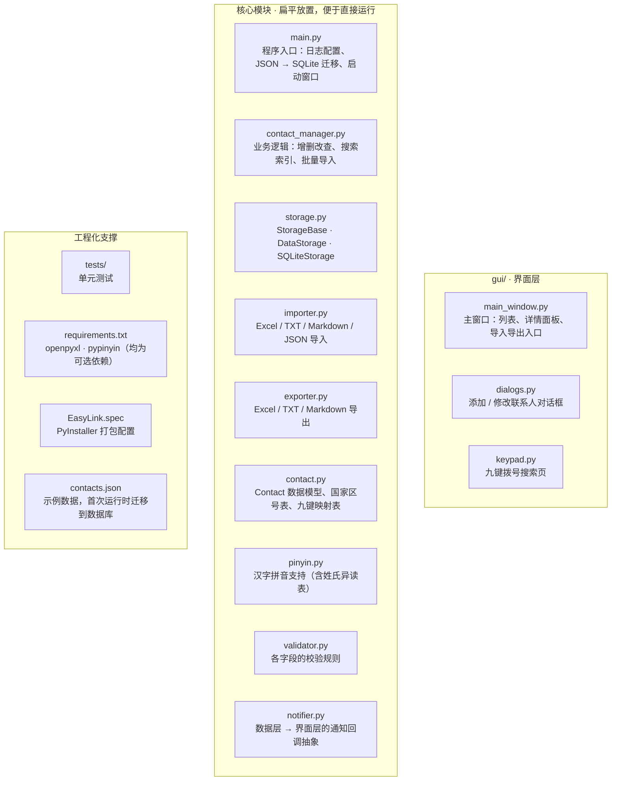
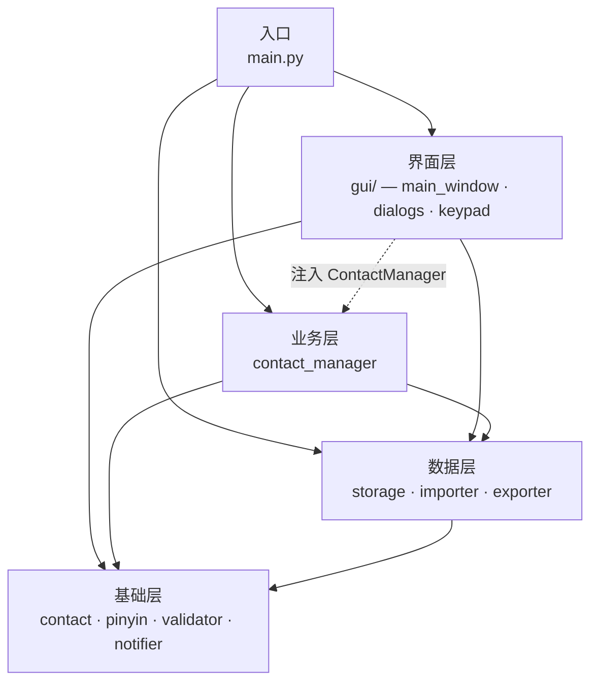

# EasyLink · 个人通讯录管理系统

一个基于 **Python + Tkinter** 的桌面通讯录工具，支持联系人增删改查、常用标记、统一搜索、
九键拨号搜索，以及 Excel / TXT / Markdown / JSON 四种格式的导入导出。

数据默认存放在 SQLite 数据库中，每次修改即时落盘；随仓库提供的 `contacts.json`
会在首次运行时自动迁移进数据库。

---

## 功能特性

| 分类 | 说明 |
|---|---|
| 联系人管理 | 添加、修改、删除；电话在库中唯一，重复号码会被拒绝 |
| 常用联系人 | 单独标签页展示，一键标记／取消标记 |
| 统一搜索 | 一个输入框同时匹配姓名、**拼音**、电话、邮箱与九键数字编码，不区分大小写 |
| 九键搜索 | 独立拨号键盘，按数字序列**前缀**匹配姓名的九键编码；中英文姓名均可检索 |
| 拼音支持 | 中文姓名自动转换为拼音参与检索，并处理姓氏异读（单 shàn、解 xiè 等） |
| 国家识别 | 依据国际区号自动识别国家/地区，`+886`、`+852`、`+853` 等长区号优先匹配 |
| 数据导入 | Excel(`.xlsx`)、TXT、Markdown、JSON；自动跳过重复号码与无效记录 |
| 数据导出 | Excel、TXT、Markdown；导出内容可原样导入回来 |
| 数据存储 | SQLite 即时提交；JSON 存储采用「临时文件 + 原子替换」 |
| 数据保护 | 若磁盘上存在无法解析的记录，覆盖写之前自动备份原文件 |
| 运行日志 | 控制台 + `easylink.log`，打包成无控制台程序后仍可追溯问题 |

## 运行要求

- **Python 3.8+**
- `tkinter`：图形界面，标准库自带。Windows / macOS 官方 Python 已内置；
  部分 Linux 发行版需要额外安装 `python3-tk`
- `openpyxl`：仅 Excel 导入导出需要
- `pypinyin`：仅中文姓名的九键／拼音检索需要，英文姓名不受影响

后两者都是**可选依赖**：未安装时程序仍可正常启动，只是对应功能不可用并给出安装提示。
执行 `pip install -r requirements.txt` 即可一并安装。

## 安装与运行

```bash
git clone https://github.com/scientificmaniac/EasyLink.git
cd EasyLink

# 建议先创建虚拟环境
python -m venv .venv
.venv\Scripts\activate        # Windows
# source .venv/bin/activate   # macOS / Linux

pip install -r requirements.txt
python main.py
```

## 项目结构



## 数据文件

以下文件都位于 `main.py` 同级目录（程序启动时会切换工作目录到该目录）：

| 文件 | 说明 | 是否纳入版本控制 |
|---|---|---|
| `contacts.db` | SQLite 数据库，主存储 | 否 |
| `contacts.json` | 示例／迁移源数据 | 是 |
| `contacts.xlsx` / `.txt` / `.md` | 导出产物 | 否 |
| `easylink.log` | 运行日志 | 否 |
| `contacts.json.*.bak` | 检测到无法解析的记录时自动生成的原文件备份 | 否 |

### 覆盖写保护

加载时无法解析的记录不会进入内存，但它们仍存在于磁盘上。为了避免「一次保存就永久丢数据」，
程序在覆盖写之前会先把原文件复制为 `contacts.json.<时间戳>.bak`；若备份本身失败，
则中止保存而不是静默丢弃。

## 导入导出格式

导出表格的列顺序为：

```
姓名 | 电话 | 邮箱 | 国家/地区 | 备注 | 常用联系人
```

导入时会按同一列序解析：

- **国家/地区**由系统依据电话号码自动推断，导入时忽略该列
- Markdown 中的竖线会在导出时转义为 `\|`，导入时还原，因此备注里的 `|` 不会撑破表格
- 备注、邮箱为空的记录同样可以正常往返
- Excel 中以数字格式保存的电话号码（如 `13800138000`）不会变成 `13800138000.0`

## 使用说明

- **添加 / 修改 / 删除**：工具栏按钮，或双击列表行打开修改对话框
- **标记为常用**：右侧详情面板底部的「标记为常用」按钮
- **搜索**：顶部输入框输入关键词后点「搜索」或按回车；「重置」恢复完整列表
- **九键搜索**：切到「九键搜索」标签页 → 「打开拨号键盘」→ 点击数字键，边输入边出结果
- **导入 / 导出**：右侧「数据导入 / 数据导出」区域

### 九键搜索与拼音

九键编码由**拼音字母**生成（`a`–`z` → `2`–`9`）：

| 姓名 | 拼音 | 九键编码 |
|---|---|---|
| 张明 | zhangming | `942646464` |
| 李四 | lisi | `5474` |
| Emma Wilson | emmawilson | `3662945766` |
| 单雄信 | shanxiongxin | `742694664946` |

- 匹配方式是**前缀匹配**：输入 `94` 会逐步收窄到「张明」，
  而不会命中编码中段含 `94` 的其他人
- 中文姓名由 `pypinyin` 转换为拼音，**未安装时只有英文姓名能被九键检索到**，
  其余功能不受影响
- **姓氏异读**已被覆盖：`单`、`解`、`仇`、`查`、`曾` 等字作姓氏时读音与常用读音
  不同，程序会同时保留两套编码，按任一种读音输入都能搜到（例如「单雄信」
  输入 `7426`(shàn) 或 `326`(dān) 均可命中）
- 顶部的统一搜索框同样支持**直接输入拼音**，如输入 `zhang` 或 `lisi`

## 测试

测试使用标准库 `unittest`：

```bash
python -m unittest discover -s tests -t . -v
```

- 未安装 `openpyxl` 时，Excel 相关用例会自动跳过，其余用例照常运行
- 拼音的降级行为通过 mock 模拟「未安装 pypinyin」的场景，不依赖运行环境

## 开发说明

### 分层与依赖方向



图中每个节点代表一层，节点内列出该层的模块；**实线**为 `import` 依赖，
**虚线**为通过构造函数注入的运行时依赖（`main.py` 创建 `ContactManager` 后
传给界面层，界面层并不 `import` 它）。所有箭头一致指向下层，不存在反向依赖。

- **基础层不依赖任何上层**：`contact` / `pinyin` / `validator` / `notifier`
  只依赖同层或更底层模块，因此可以脱离 GUI 与数据库单独测试
- **数据层（`importer` / `exporter`）不导入 `tkinter`**：面向用户的提示通过
  `notifier` 回调交给界面层，因此这些模块可以在命令行或测试中直接使用
- **`openpyxl` / `pypinyin` 均采用惰性导入**：缺失时不影响程序启动与其它功能，
  只在真正用到该功能时给出安装提示
- **日志配置只出现在 `main.py`**：库模块仅获取 logger，不调用 `basicConfig`，
  以免覆盖宿主应用的日志设置
- **索引一致性**：`ContactManager._search_cache` 是 `storage.contacts` 的派生索引，
  任何改动联系人集合的操作都必须重建它

## 打包

```bash
pip install pyinstaller
pyinstaller EasyLink.spec
```

产物位于 `dist/`，构建中间文件位于 `build/`，两者均已在 `.gitignore` 中忽略。

`pypinyin`（约 3 MB 拼音词典）与 `openpyxl` 都自带 PyInstaller hook，其数据文件会在
打包时被自动收集，无需在 `EasyLink.spec` 中额外配置。若打包后的程序中文九键搜索失效，
请检查 `dist/` 内是否缺少 `pypinyin/phrases_dict.json`。

## 许可证

本项目基于 [MIT License](LICENSE) 开源。
